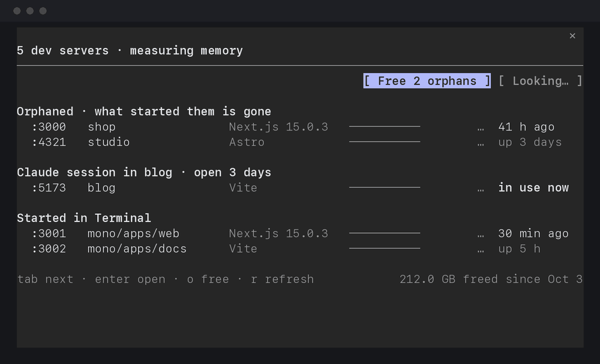

# devservers

Every dev server running on your Mac, what it holds in memory and when you last used it, and a way to stop the ones you forgot, without leaving Claude Code.



## Why

Claude Code starts `pnpm dev` in the background all the time, and when a session ends its dev server keeps running. A Next.js dev server grows to 2 to 6 GB over a few days, and macOS charges all of it to the terminal it came from, so iTerm or Terminal looks like it is eating your memory. On the Mac this was built on, that was 22 dev servers holding 77 GB, 15 of them left behind by sessions that had ended.

## Install

At the prompt of a Claude Code terminal session:

```
/plugin install devservers --marketplace MicoBlanc/devservers
```

Answer `y` to add the marketplace, then press Enter for the user scope, which loads it in every session from then on.

From a shell:

```
claude plugin install devservers --marketplace MicoBlanc/devservers
```

In the Claude desktop app, where `/plugin` does not run: click **+** next to the prompt box, then **Plugins**, **Add marketplace** with `MicoBlanc/devservers`, then **Add plugin**.

## Use

Type `/devservers`. The pane opens at once, your servers land a moment later, and their memory fills in as macOS measures it.

- **The bar at the top** is all the memory your dev servers hold. The yellow part is orphaned: servers whose Claude session or terminal is gone, so nothing will ever stop them. **Free** stops the ones nobody has open, after one more press.
- **The rows** are grouped by what started them: orphaned, a Claude session that is still open, a terminal (iTerm, Terminal, Ghostty, VS Code, tmux...) or an app. Each shows its port, folder, memory and when it was last used.
- **Enter on a row** shows when and how it was started, with **Stop and free**, **Open in browser**, and **Copy start command**, which puts the exact line to start it again on your clipboard, like `cd ~/code/shop && pnpm dev`.
- **Stopping is something you watch.** Every server gets the signal at the same moment, each bar drains as its process exits, and the header counts what came back.
- **The last line** keeps the total devservers has freed on this Mac.

Keys while the pane has focus: Tab moves between rows and buttons, Enter opens a row or presses a button, `o` frees the orphans, `r` refreshes, Esc closes.

From the prompt:

| Command | Does |
| --- | --- |
| `/devservers` | Opens the pane |
| `/devservers list` | Prints the same table as text |
| `/devservers stop 3000` | Stops the server on port 3000, and says how to start it again |
| `/devservers stop orphans` | Stops every orphan nobody has open |

## How it decides

- **What counts as a dev server**: a process of yours listening on a TCP port that a known framework started (Next.js, Vite and what runs on it, Astro, Nuxt, Storybook, Angular, webpack, Expo, Gatsby, Docusaurus, Remix), or that a `pnpm`, `npm`, `yarn` or `bun` `dev`, `start` or `serve` script started. Databases, Docker and desktop apps are left out.
- **Orphaned**: nothing above the server is left but macOS itself. When the shell Claude Code ran it in is still there, the row says a Claude session started it.
- **Last used**: Next.js 16 and later keep a dev log. devservers reads the last page view, browser message or server log in it, and skips Turbopack's own cache writes, which happen with nobody around. A server with a browser tab or another client connected shows **in use now**. Where a framework keeps no log, the row says how long the server has been up.
- **Memory**: the figure Activity Monitor shows, compressed and swapped memory included, added up over every process that exists only to run the server.
- **Start command**: the package script that started it (`pnpm dev -p 3001`), else the framework's own command run through `npx`, in the folder it ran in.

## What a stop does

- It sends SIGTERM to the server and to the processes that exist only to run it (`pnpm`, `next dev`, the shell that launched them), all at once, waits up to 8 seconds, then sends SIGKILL to whatever is left.
- In a monorepo, stopping one app of a `turbo dev` leaves the other apps running.
- It refuses when the server already exited and its process ID now belongs to something else.

## Privacy

Everything runs on your Mac with `ps`, `lsof`, `top`, `git` and `tail`. No network calls, no telemetry. Nothing runs in the background: devservers only looks when you run `/devservers`, and only stops what you press.

## Requirements

- macOS. Linux and Windows are next.
- Claude Code with mods; tested with 2.1.303.

## The recording

The recording above is a made-up Mac. `demo/` is a second mod that answers devservers' process, `HOME` and store calls with made-up projects, so no real folder shows and no real total changes. Run `claude --plugin-dir demo` beside an installed devservers to try the pane without touching anything.

## License

MIT
